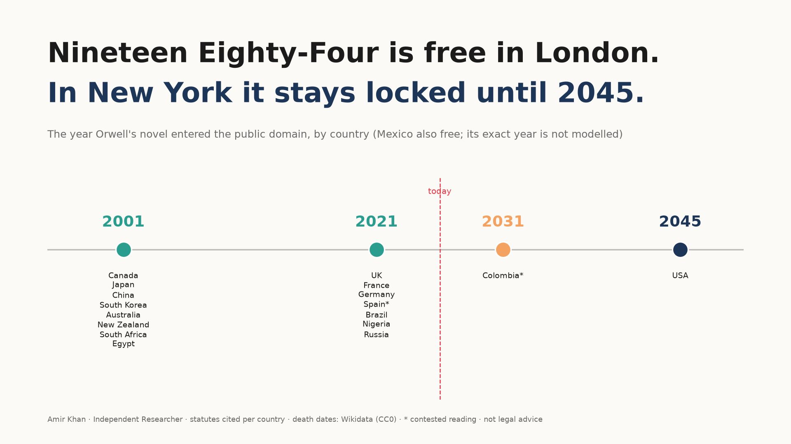
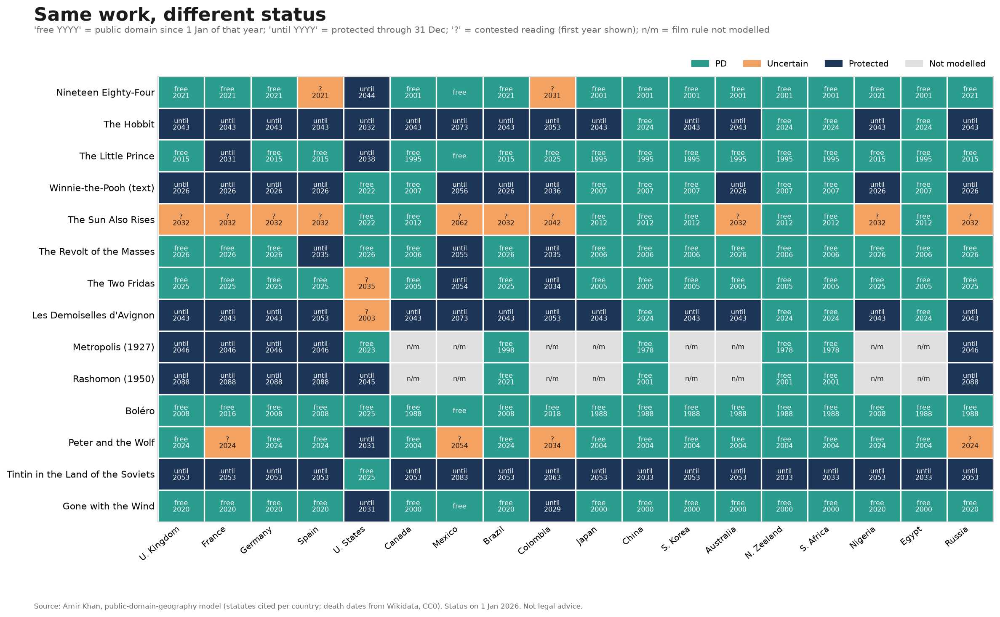

# The Geography of the Public Domain

**Question:** When does a classic become free for everyone, and does the answer depend on where you stand?
**Finding:** Yes, by decades. Of 80 famous books, films, scores and paintings, 45 are public domain in at least one of 18 countries and still protected in another. The median gap between the first and last country to free a work is 50 years; for *Rashomon* it is 88. *Nineteen Eighty-Four* has been free in the UK since 2021, in Canada and New Zealand since 2001, and in the US not until 2045.
**Recommendation:** Anyone publishing, streaming, teaching with or training models on "public domain" works should ask *public domain where?* and check each target country, not just US law.

Author: Amir Khan, Independent Researcher · [github.com/amirator](https://github.com/amirator)

[](https://github.com/amirator/public-domain-geography/actions/workflows/ci.yml)



## What it does

`run.py` builds a matrix of **80 works × 18 countries** (1,440 cells), showing public-domain status on **1 January 2026**:

1. **Death dates** for all 84 creators come from Wikidata (CC0) via the public API (`src/wikidata.py`). Results are cached in `data/wikidata_creators.json` and cross-checked against an editor's expectation; mismatches are printed.
2. **Country rules** (`src/rules.py`) encode each country's statutory term and transitional rules. Examples: Spain's life+80 for authors who died before 1987, Mexico's non-retroactive life+100, Canada's and Japan's non-retroactive extensions, the US 1930 publication cut-off and URAA restoration, French *mort pour la France* and wartime extensions, Japan's wartime extension for Allied nationals, Russia's +4 years, and EU/UK film-author rules. Every rule is cited in `data/country_rules.csv`.
3. **Honest uncertainty:** cells are `PD`, `Protected`, `Uncertain` (two defensible readings, both years kept) or `Not modelled` (film rules not coded for 8 countries).
4. **Charts** (`src/charts.py`): world map, a "same work, different status" grid, an unlock timeline, the full 80×18 heatmap and a header card.
5. **Article** (`src/build_article.py`): fills the article table from the data and renders Markdown and HTML.



## Run

```bash
python -m venv .venv && source .venv/bin/activate
pip install -r requirements.txt
python run.py                 # cached Wikidata; add --refresh to re-query
python -m src.build_article   # article/article.md + article/article.html
pytest -q                     # 17 tests; each pins a fact verified in a published source
```

Requirements are pinned in `requirements.txt` (Python 3.13).

## Outputs

| Path | What |
|---|---|
| `results/pd_matrix_long.csv` | One row per work × country: status, first free year, alternative year, rule applied |
| `results/pd_matrix_wide.csv` | Human-readable grid |
| `results/summary.json` | Headline numbers |
| `charts/*.png` | Five charts |
| `article/` | Article (Markdown, HTML, Medium-ready Markdown) and LinkedIn teaser |

## Headline numbers (as of 1 Jan 2026)

| Country | % of modelled works in the public domain |
|---|---|
| South Africa, New Zealand, China | 86% |
| Egypt | 84% |
| Canada | 72% |
| United States | 56% |
| UK, Germany | 39% |
| France | 34% |
| Spain, Colombia | 28% |

## Limits

- Models the **underlying work** only: not translations, editions, sound recordings, restorations, trademarks or moral rights.
- The rule of the shorter term is modelled for the UK, EU, Japan and Russia. In other countries the cell is flagged when a foreign work is already free at home.
- US renewal records, simultaneous publication and unpublished-work rules were not checked title by title. They are flagged where they matter.
- Music dates are composition or first-publication years; exact publication can shift US dates.
- A research model, **not legal advice**.

## Licence

- **Code** (`src/`, `run.py`, `tests/`, workflow files): [MIT](LICENSE).
- **Article text** (`article/`) and **charts** (`charts/`): [CC BY 4.0](LICENSE-CC-BY-4.0).
- **Wikidata** death dates (`data/wikidata_creators.json`): [CC0](https://creativecommons.org/publicdomain/zero/1.0/).
- **Natural Earth** country boundaries: public domain (downloaded at run time, not stored here).
- **Statutes** cited in `data/country_rules.csv` remain the work of the issuing governments.

*This repository is research and commentary, not legal advice.*
