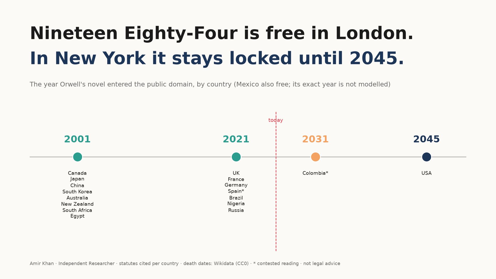
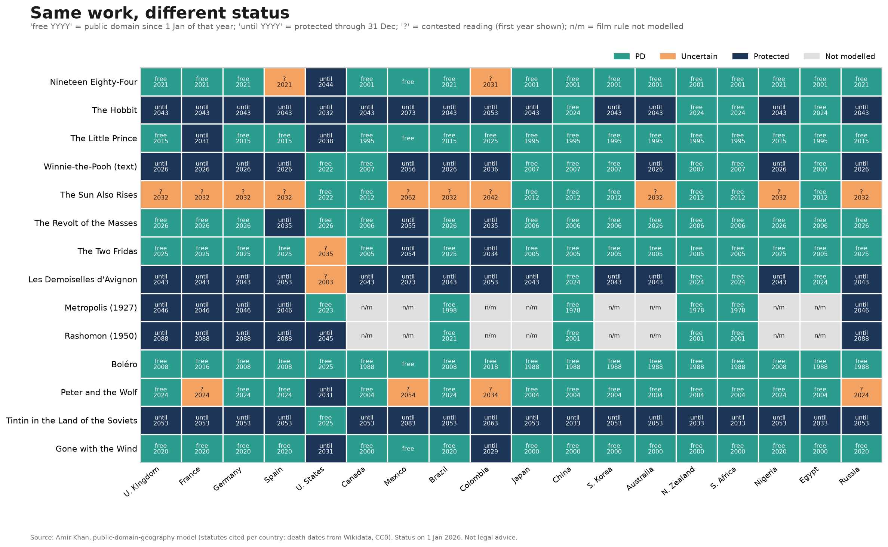
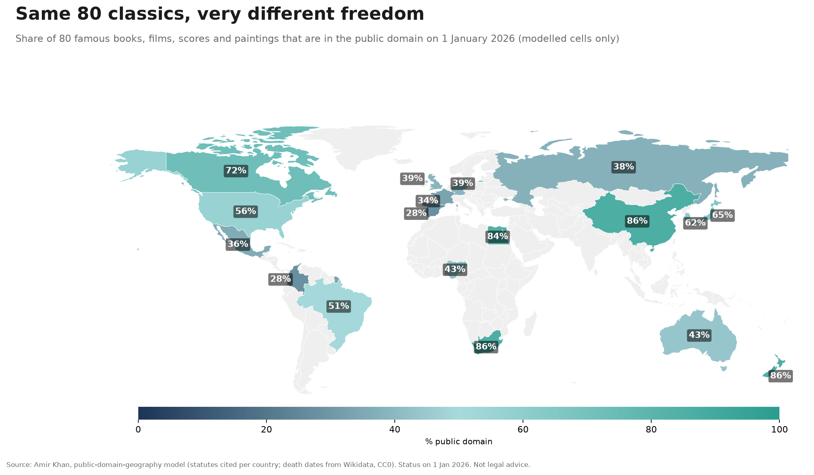
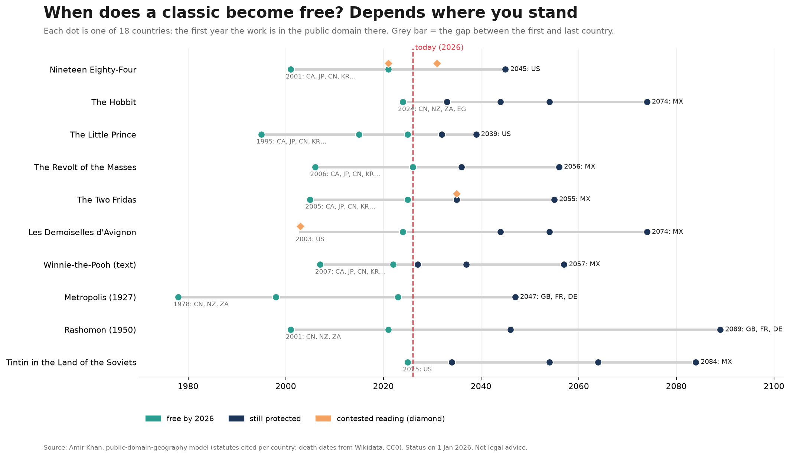

# Big Brother Is Free in London. In New York, He Is Locked Until 2045.

*I mapped 80 classics across 18 countries. The public domain is not a date. It is a border.*

**Amir Khan** · Independent Researcher · Draft, November 2026

On 1 January 2021, anyone in London could legally print, translate, adapt or sell George Orwell's *Nineteen Eighty-Four* without asking anyone's permission. Do the same thing in New York today and you are still using a work under copyright, one that will not expire until 1 January 2045.

It is hard to invent a better irony. Orwell wrote a novel about a state that decides what the past is allowed to be. Seventy-five years later, whether his book belongs to everyone depends on which state you are standing in. In Toronto, Auckland, Beijing, Seoul, Cairo and Johannesburg, it has been free since 2001. In London, Paris and Berlin, since 2021. In New York, not for another two decades.

We talk about "the public domain" as if it were one place, a shared commons that every great work eventually reaches. It isn't. It is a patchwork of national laws, wartime exceptions, transitional clauses and old treaties. That patchwork decides, quietly, who may publish, stream, teach or train on the culture we call classic.

So I tried to measure it.

## What I measured

I built a matrix of **80 famous works**: 43 books, 11 films, 13 musical compositions and 13 artworks. They range from Kafka and Lu Xun to Frida Kahlo, *Rashomon* and *Boléro*. I set them against **18 countries** on six continents: the United Kingdom, France, Germany, Spain, the United States, Canada, Mexico, Brazil, Colombia, Japan, China, South Korea, Australia, New Zealand, South Africa, Nigeria, Egypt and Russia.

For each country I coded its copyright term from the statute itself. That meant the UK's Copyright, Designs and Patents Act, the EU Term Directive, Title 17 of the US Code, Mexico's Ley Federal del Derecho de Autor, Japan's Copyright Act and so on, including the transitional rules that decide who was grandfathered in. Death dates for all 84 creators come from Wikidata (CC0). The result is 1,440 cells, each recording the status on **1 January 2026** and the rule that produced it.

I did not force an answer where the law is genuinely unsettled. **87 cells are marked "contested"**, mostly where an old treaty rule called the *rule of the shorter term* may apply. **88 film cells are "not modelled"**, because some countries' film rules are too tangled to code honestly. Everything else rests on a cited rule. The code, data and every citation accompany this article.

## Finding 1: The same work has a different legal status depending on where you stand

Of the 80 works, **45 are in the public domain in at least one country and protected in another**. For the typical work, the gap between the first country to free it and the last is **50 years**.

| Work | UK | France | Spain | USA | Canada | Mexico | China | N. Zealand |
|---|---|---|---|---|---|---|---|---|
| *Nineteen Eighty-Four* | free 2021 | free 2021 | ? (2021) | to 2044 | free 2001 | free | free 2001 | free 2001 |
| *The Hobbit* | to 2043 | to 2043 | to 2043 | to 2032 | to 2043 | to 2073 | free 2024 | free 2024 |
| *The Little Prince* | free 2015 | to 2031 | free 2015 | to 2038 | free 1995 | free | free 1995 | free 1995 |
| *The Revolt of the Masses* | free 2026 | free 2026 | to 2035 | free 2026 | free 2006 | to 2055 | free 2006 | free 2006 |
| *The Two Fridas* | free 2025 | free 2025 | free 2025 | ? (2035) | free 2005 | to 2054 | free 2005 | free 2005 |
| *Les Demoiselles d'Avignon* | to 2043 | to 2043 | to 2053 | ? (2003) | to 2043 | to 2073 | free 2024 | free 2024 |
| *Winnie-the-Pooh* | to 2026 | to 2026 | to 2026 | free 2022 | free 2007 | to 2056 | free 2007 | free 2007 |
| *Metropolis (1927)* | to 2046 | to 2046 | to 2046 | free 2023 | n/m | n/m | free 1978 | free 1978 |
| *Rashomon (1950)* | to 2088 | to 2088 | to 2088 | to 2045 | n/m | n/m | free 2001 | free 2001 |
| *Tintin in the Land of the Soviets* | to 2053 | to 2053 | to 2053 | free 2025 | to 2053 | to 2083 | to 2033 | to 2033 |

*"free 2021" = public domain since 1 January 2021; "to 2044" = protected until 31 December 2044; "?" = contested.*

## Finding 2: Some countries lock up their own greatest work the longest

Nationalism shows up in copyright law in a strange way.

José Ortega y Gasset's *The Revolt of the Masses* (1930), one of the most influential works of 20th-century European philosophy, entered the public domain on **1 January 2026** in the UK, France, Germany and the United States. In **Spain**, the author's own country, it stays protected until the end of 2035. A transitional clause in Spain's intellectual property law keeps the old 80-year term for authors who died before 7 December 1987. In **Mexico**, it is protected until the end of 2055.

The same clause means Pablo Picasso's paintings become free in Spain only in 2054, ten years later than in France, where he lived and worked.

Frida Kahlo is the starkest case. Her work entered the public domain across most of Europe in 2025. In **Mexico**, it stays protected until the end of 2054. Mexico has the longest standard copyright term in the world: life plus 100 years.

## Finding 3: The wars of the 20th century are still adding years

*The Little Prince* was first published in New York in 1943. Antoine de Saint-Exupéry disappeared on a reconnaissance flight over the Mediterranean in July 1944. His book entered the public domain in most of the EU in 2015, and in Canada as early as 1995.

In **France** it is protected until the end of 2031. French law adds 30 years for authors officially declared *mort pour la France* (Article L123-10 of the Intellectual Property Code), plus a wartime extension of 8 years and 120 days. *Boléro* got a similar bonus: Ravel's best-known work became free in Germany and the UK in 2008, but in France only on 1 May 2016.

Japan has its own echo of the war. Works by authors from the US, UK, France, Canada, Australia and New Zealand that were protected before the Pacific War can carry up to **3,794 extra days** under a 1952 law tied to the San Francisco Peace Treaty.

## Finding 4: Film is where the map goes wild

Film terms are calculated in completely different ways. In the EU and UK, a film is protected until 70 years after the death of the last of its principal director, screenwriter, dialogue author and composer. In China, New Zealand and South Africa, protection runs 50 years from release. In the US, it runs 95 years from publication.

So Fritz Lang's *Metropolis* (1927) has been free in the United States since 2023 and in China since 1978. In Germany, its home country, it stays protected until the end of 2046.

Akira Kurosawa's *Rashomon* (1950) shows the widest gap in the whole dataset: **88 years**. Under China's release-based rule it has been free since 2001. In the EU and UK it is protected until the end of 2088, because its co-screenwriter, Shinobu Hashimoto, died in 2018.

## Finding 5: Where you live decides how much of the canon you own

The most open countries in my sample are the ones that never extended their terms beyond the Berne minimum of life plus 50. **South Africa, New Zealand and China each have 86%** of the modelled works in the public domain, and **Egypt has 84%**. Canada has 72%, because its 2022 extension to life plus 70 did not revive anything already free.

At the other end, **Spain and Colombia each have only 28%**, France 34% and Mexico 36%. The US sits in the middle at 56%. That is not because its terms are short. It is because anything *published* in 1930 or earlier is now free there, no matter when the author died. That rule is why Dashiell Hammett's *The Maltese Falcon* and Agatha Christie's *The Murder at the Vicarage* became free in the US on 1 January 2026, while Christie's book stays protected in Britain until the end of 2046.

The asymmetry runs both ways. Five works in the sample are free in the UK but locked in the US, including *Nineteen Eighty-Four*, *Animal Farm* and *Gone with the Wind*. Sixteen are free in the US but locked in the UK, among them *Winnie-the-Pooh*, *Metropolis*, *The Rite of Spring* and Chaplin's *The Kid*.

## Five cases that sound made up but aren't

- **Middle-earth is free in Middle-earth.** J.R.R. Tolkien died in 1973. Under New Zealand's life-plus-50 rule, his books entered the public domain there on 1 January 2024. In the UK they are protected until the end of 2043.
- **Peter Pan never fully leaves.** Barrie's work is long out of copyright, yet UK law gives Great Ormond Street Hospital a *perpetual* right to royalties from performances, publications and adaptations of the play *Peter Pan* (CDPA 1988, s.301 and Schedule 6).
- **A British-made horror film built on an American public domain.** *Winnie-the-Pooh* (1926) entered the US public domain in 2022. A UK filmmaker turned it into the slasher film *Winnie-the-Pooh: Blood and Honey*, which had its world premiere in Mexico in January 2023. On the statutes, Milne's text is protected in Mexico until the end of 2056 and in the UK until the end of 2026. I make no claim about how the producers cleared it, but the map shows exactly why such questions arise.
- **Tintin is free in America.** Hergé's first adventure, *Tintin in the Land of the Soviets* (1929–30), entered the US public domain in 2025. In Belgium and the rest of the EU it is protected until the end of 2053.
- **Mickey Mouse can't cross the Atlantic.** *Steamboat Willie* (1928) became free in the US in 2024. In the UK and EU it is contested. It may be free under the rule of the shorter term, or protected until 2041 under the life-plus-70 rule for its directors.

## The grey zone

The contested cells deserve their own spotlight, because they are where lawyers earn their fees.

The **rule of the shorter term** says a country may protect a foreign work for no longer than its home country does. Ernest Hemingway's *The Sun Also Rises* became free in the United States in 2022. So is it free in Paris? The rule says probably yes. The plain life-plus-70 term says not until 2032. In 2014, Germany's Federal Court of Justice applied the shorter US term to *Tarzan of the Apes*, but through a 1952 treaty rather than the EU rule.

Elsewhere, US status depends on whether a painting was ever "published", a question the law has never answered cleanly for artworks. And it is unclear whether Spain's 80-year term extends to foreign authors who were EU nationals at the time, which would include British authors like Orwell before 2020. In all these cases I mark the cell "?" and give both dates.

## Why this matters beyond lawyers

- **Publishers** sell by territory. An edition that is legal in Toronto can be an infringement if it ships to London or Mexico City. Project Gutenberg, the largest free e-book library, applies US law and tells readers outside the US to check their own country's law before using a text.
- **Streaming platforms** operate globally, but adaptation rights are national. A "public domain" Pooh, Mickey or Tintin project can be legally clear in one market and blocked in the next.
- **Teachers** sharing a full text with an online class that spans several countries may be on safe ground for some students and not others.
- **AI training data.** Datasets labelled "public domain books" are usually assembled under US rules. My matrix suggests that a text which is clean in one jurisdiction is often still protected in another. Anyone building a "public domain" corpus should ask: *public domain where?*

## The question

Culture moves across borders instantly, but its legal status still depends on where you stand. On the same morning, *The Revolt of the Masses* was set free in Berlin and stayed locked in Madrid.

So, a question I would genuinely like answered: **should the world have one public-domain date for a work, or is it right that each country decides when a classic belongs to everyone?** And if we had one date, whose clock should we use?

*This article is research and commentary, not legal advice.*

---

### Method in brief

Status is calculated as of 1 January 2026 for the underlying work only: the text, the score, the painting or the film. It does not cover translations, new editions, sound recordings, restorations, trademarks or moral rights. Terms run to the end of the calendar year. The rule of the shorter term is modelled for the UK, the EU countries, Japan and Russia. In other countries, where a foreign work is free at home but protected locally, the cell is marked contested. Unpublished-work rules, simultaneous publication and US renewal records were not checked title by title; where they matter, the cell says so. Death dates come from Wikidata (CC0) and were cross-checked against an independent expectation, which turned up one discrepancy (Gottfried Huppertz, 1937). Wikidata's value was used.

### References

1. Guardian, "George Orwell is out of copyright. What happens now?", 1 Jan 2021. https://www.theguardian.com/books/booksblog/2021/jan/01/george-orwell-is-out-of-copyright-what-happens-now
2. Duke Law, Center for the Study of the Public Domain, *Public Domain Day 2026* (CC BY 4.0). https://web.law.duke.edu/cspd/publicdomainday/2026/
3. UK Copyright, Designs and Patents Act 1988, s.12 and s.13B. https://www.legislation.gov.uk/ukpga/1988/48/section/12 ; https://www.legislation.gov.uk/ukpga/1988/48/section/13B
4. UK CDPA 1988, Schedule 6 (Peter Pan royalty). https://www.legislation.gov.uk/ukpga/1988/48/schedule/6
5. Directive 2006/116/EC on the term of protection of copyright. https://eur-lex.europa.eu/eli/dir/2006/116/oj
6. US Code, Title 17, §304 and §104A. https://www.law.cornell.edu/uscode/text/17/304 ; https://www.law.cornell.edu/uscode/text/17/104A
7. France, Code de la propriété intellectuelle, art. L123-10 (Légifrance). https://www.legifrance.gouv.fr/codes/article_lc/LEGIARTI000006278952
8. Syndicat national de l'édition, "Durée des droits d'auteur" (wartime extensions; Cour de cassation, 27 Feb 2007). https://www.sne.fr/editeur-et-auteur/duree-des-droits-dauteurs/
9. franceinfo, "Pourquoi 'Le Petit Prince' n'est-il pas libre de droits en France ?", 30 Jul 2015. https://www.franceinfo.fr/culture/cinema/pourquoi-le-petit-prince-n-est-il-pas-libre-de-droits-en-france_1021265.html
10. France Musique, "Les droits d'auteur des œuvres de Ravel : un cas d'école juridique", 3 May 2016. https://www.radiofrance.fr/francemusique/les-droits-d-auteur-des-oeuvres-de-ravel-un-cas-d-ecole-juridique-2427277
11. Germany, Urheberrechtsgesetz §64. https://www.gesetze-im-internet.de/urhg/__64.html ; BGH, judgment of 26 Feb 2014, I ZR 49/13 ("Tarzan"). https://ra.de/bgh/i-zr-49-13-2014-02-26
12. Spain, Real Decreto Legislativo 1/1996 (Ley de Propiedad Intelectual), art. 26 and Disposición transitoria cuarta. https://www.boe.es/buscar/act.php?id=BOE-A-1996-8930 ; Biblioteca Nacional de España, "Obras en dominio público". https://consultas.bne.es/faq/267300
13. Mexico, Ley Federal del Derecho de Autor, art. 29. https://www.diputados.gob.mx/LeyesBiblio/pdf/LFDA.pdf ; Wikimedia Commons, "Copyright rules by territory/Mexico" (term history). https://commons.wikimedia.org/wiki/Commons:Copyright_rules_by_territory/Mexico
14. R3D, "Frida Kahlo entró al dominio público en la Unión Europea; en México, a esperar 30 años más", 7 Jan 2025. https://r3d.mx/2025/01/07/frida-kahlo-entro-al-dominio-publico-en-la-union-europea-en-mexico-a-esperar-30-anos-mas/
15. Canada, Copyright Act s.6, and Budget Implementation Act 2022, No. 1 (term extension, 30 Dec 2022). https://laws-lois.justice.gc.ca/eng/acts/C-42/page-3.html ; https://laws.justice.gc.ca/eng/AnnualStatutes/2022_10/page-21.html
16. New Zealand, Copyright Act 1994, s.22 (as at 13 Nov 2025). https://www.legislation.govt.nz/act/public/1994/0143/latest/link.aspx?id=DLM345931 ; Stuff, "Legal copyright expires for Lord of the Rings books but only in New Zealand", Jan 2024. https://www.stuff.co.nz/nz-news/350464454/legal-copyright-expires-for-lord-of-the-rings-books-but-only-in-new-zealand-lawyer-says
17. Japan, Copyright Act (Act No. 48 of 1970), art. 51 (e-Gov). https://laws.e-gov.go.jp/law/345AC0000000048 ; Act on Exceptional Provisions for Copyrights Owned by the Allied Powers (Act No. 302 of 1952), WIPO Lex. https://www.wipo.int/wipolex/en/legislation/details/2659
18. China, Copyright Law (2020 amendment), art. 23, WIPO Lex. https://www.wipo.int/wipolex/en/legislation/details/21065
19. Korea Copyright Commission, Copyright Act art. 39 (English). https://www.copyright.or.kr/eng/laws-and-treaties/copyright-law/chapter02/section04.do
20. Australia, Copyright Act 1968 s.33. https://austlii.edu.au/au/legis/cth/consol_act/ca1968133/s33.html ; Attorney-General's Department, Duration of Copyright table. https://www.ag.gov.au/rights-and-protections/publications/duration-copyright-table
21. South Africa, Copyright Act 98 of 1978, s.3. https://www.acts.co.za/copyright/3_copyright_by_virtue_of_nationality_domicile_or_residence_and_duration_of_copyright
22. Nigeria, Copyright Act 2022, s.19. https://nipc.gov.ng/assets/resources/copyright-act-2022/copyright-act-2022.pdf
23. Egypt, Law No. 82 of 2002, art. 160, WIPO Lex. https://www.wipo.int/wipolex/en/legislation/details/22066
24. Russia, Civil Code arts. 1281 and 1256 (ConsultantPlus). https://www.consultant.ru/document/cons_doc_LAW_64629/675b81f0bc9b8ecd68ea332ecfd9d1562541fb98/ ; https://www.consultant.ru/document/cons_doc_LAW_64629/8de289f9f127f87e4195dbfb40e9b18bf22b156b/
25. Brazil, Lei 9.610/1998, arts. 41 and 44. https://www.planalto.gov.br/ccivil_03/leis/l9610.htm
26. Colombia, Ley 23 de 1982, art. 11. http://www.secretariasenado.gov.co/senado/basedoc/ley_0023_1982.html
27. BBC Culture, "The gory new Winnie the Pooh horror causing a storm", 16 Feb 2023. https://www.bbc.com/culture/article/20230215-the-gory-new-winnie-the-pooh-horror-causing-a-storm
28. France 24 / AFP, "Tintin, Popeye, Hemingway among US copyrights expiring in 2025", 1 Jan 2025. https://www.france24.com/en/live-news/20250101-tintin-popeye-hemingway-among-us-copyrights-expiring-in-2025
29. Project Gutenberg, "Copyright How-To". https://www.gutenberg.org/help/copyright.html
30. Wikidata (CC0), creator death dates (P570), retrieved 25 Nov 2026. https://www.wikidata.org/
